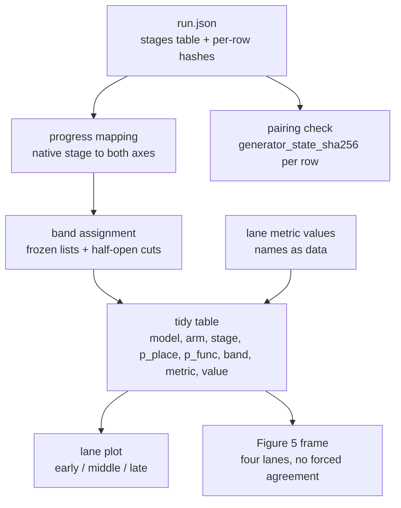

# VAR-DiT Progress Mapping, Plot Template and Gate B Pilot - Plan

## Goal Capsule

- **Objective:** Group 17 can place every lane's finding on one agreed generation-progress axis and compare VAR against DiT without claiming the two are mechanically equivalent; and P4 can show, from paired runs a teammate can reproduce, that a budget-matched four-arm protocol — baseline, protect, damage, matched control — runs on both models and discriminates where a reduction budget is spent. Whether protecting important stages preserves image quality is the question the deferred full sweep answers, once P3's calibrated metrics exist.
- **Means:** Bands placed on the native/index axis, with the functional value carried alongside every stage as a reporting convention (KTD1, KTD2) — plus a fixed reduction budget that makes protect, damage and control exactly comparable (KTD6).
- **Authority hierarchy:** The frozen experimental contract outranks this plan — `VAR Audit Integrated Research and Execution Plan.md` §4 and `docs/HANDOVER.md` §3. This plan outranks implementer preference. Where this plan and a shared doc disagree, the shared doc wins and the disagreement becomes a question for P1.
- **Execution profile:** CPU-first. Every mapping, band and template invariant is proven on tiny models on the laptop before any GPU time is spent. Results come only from NSCC.
- **Stop conditions:** Stop and ask P1 on a smoke-test `MISMATCH`; on any row whose `generator_state_sha256` differs from its baseline; on needing a hook point that does not exist; or if the work appears to require a change under `runner/`, `configs/`, `scripts/`, `jobs/` or `third_party/`.
- **Tail ownership:** P4 owns this work through to an opened pull request touching only `lanes/p4/`. P1 reviews and merges. P3 signs off on the comparison logic.

---

## Product Contract

### Summary

Build the shared stage-alignment deliverable P4 owes the group, then use it to clear P4's own Gate B. The deliverable is four named outputs: a native-stage plus normalized-progress mapping for both models, a frozen early/middle/late band definition, one importable plotting template P1–P3 use for their lane figures, the Figure 5 synthesis frame, and a usage spec that lets those three lanes call the template without reading P4's code. The pilot then runs one protect/damage experiment on each model, reporting four arms against a matched reduction budget.

The mapping reads only the `stages` table that `runner/generate.py` already writes into every `run.json`. Every field either axis needs — VAR `cum_tokens`/`total_tokens`, DiT `alpha_bar_in`/`sigma_in` — is already recorded, so nothing here requires a change to `runner/` or a dependency on another lane's output.

### Problem Frame

The shared deliverable is overdue. Its slot was 29 Sep–2 Oct and Gate A closed on 3 Oct, and the schedule puts Phase B pilots in the 4–11 Oct window now underway — P2 has already landed pilot results and a merged result schema. Until it lands, no lane can place its curves on a common axis, and Figure 5 has no frame.

The substance is a decision, not just code. `docs/hook_interface.md` "Open questions" 1 and 2 leave the progress basis open for both models and expose both candidates in the recorded fields. Meanwhile `runner/hooks.py` and `runner/dit_model.py` already pass hooks a `p` that is linear in stage index, and the `docs/HANDOVER.md` glossary already describes that `p` as "comparable across models". That claim is unearned: at VAR's index midpoint only 13.4% of its 680 tokens are committed, and at DiT's index midpoint the latent still carries `σ ≈ 0.96`. Shipping lane figures against an axis nobody has justified would put a cross-model claim in the report that the numbers do not support.

### Key Decisions

- Scope stops at Gate B. The 12–18 Oct sweeps, final Figure 4, Figure 5's content and the P1–P3 shortlist confirmation are out. Governs R12, R13, R14, R15, R16.
- The plotting template is shared infrastructure consumed by P1–P3 directly, not a P4-only helper. Governs R7, R8, R9.
- A three-point budget sweep stays inside Gate B rather than waiting for the 12–18 Oct window. It is what makes the frozen band decision testable instead of merely declared, and at one batch per arm the sampling cost is minutes; the accepted tradeoff is twenty runs and the queue latency they carry against the 11 Oct date. Governs R13.

### Requirements

**Progress mapping**

- R1. Every reported result carries the native stage (VAR `si`, DiT `timestep_in`) and a normalized progress value in [0, 1].
- R2. The plan closes `docs/hook_interface.md` open questions 1 and 2 by naming one basis per model per axis role, with the numeric reason recorded.
- R3. The mapping derives from a run's `stages` table alone. It loads no model, needs no GPU, and does not modify `runner/`.
- R4. The mapping derives scale and step counts from the table it is given, so it holds for VAR d16–d30, for the tiny CPU test models, and for a DiT run made with `--skip-timesteps`.
- R5. Progress is monotonic non-decreasing in sampling order under every supported basis and bounded in [0, 1]; it reaches exactly 0 at the first stage and 1 at the last on the placement axis only, since both functional axes start above 0.

**Band definition**

- R6. Early, middle and late are frozen as explicit native-stage lists per model, published with the boundary convention that produced them.
- R7. The band lists are fixed from the schedule alone, with no input from P1–P3 findings, so P4's pilot stays independent.

**Plot template**

- R8. One importable template produces the shared early/middle/late lane plot, and P1–P3 use it for their own figures.
- R9. A Figure 5 frame places all four lanes on the common axis and does not require them to agree or average them together.
- R18. A consumer-facing usage spec gives the tidy input contract field by field, the entry points, and one worked VAR and one worked DiT example a lane can copy.
- R10. The template accepts each metric's name, direction (higher-is-better or lower-is-better) and aggregation level (per-image or per-set) as data, so P3's final metric definitions drop in without a template change.
- R11. The template's data layer runs with no plotting library installed; only rendering requires one.

**Gate B pilot**

- R12. Each model reports four arms: baseline, protect, damage and matched control.
- R13. Protect, damage and control share one reduction budget — the same count of intervened native stages — and one intervention strength, so the contrast is where the budget is spent, not how much or how hard. For VAR that strength is λ = 0 at Gate B.
- R14. Cross-model matching is by fraction of native stages intervened and by band, never by identical operation.
- R15. Every arm's per-row `generator_state_sha256` equals its baseline's, and a run that fails this is reported, not repaired.
- R16. Every arm uses the same config, manifest and batch size 16, with the no-hook baseline produced and kept first.

**Handoff**

- R17. The comparison logic is written down for P3's sign-off: the basis per model, the band lists, the boundary convention, the arm construction and fixed-budget definition, and the numbers that rejected the alternatives.
- R19. P4 sends that spec to P3 before U8 submits, with a stated response window, records the outcome including a non-response beside the frozen band lists, and names what happens if P3 objects after other lanes have rendered figures.

### Success Criteria

- P1, P2 and P3 can build the matched VAR–DiT early/middle/late table from a `run.json` they already have, without reading P4's code, and render it as a figure as soon as a plotting library is available in the shared env.
- P3 can sign off on the comparison logic from the written spec alone.
- Gate B passes: one protect/damage pilot on each model, four arms, every row paired.
- A reader of the report can tell what "middle of generation" means for each model, in native units and in normalized progress.

### Scope Boundaries

**In scope**

- The four named shared outputs and the written comparison logic.
- P4's own NSCC lane bring-up through a passing smoke test, if not already cleared.
- One protect/damage pilot on each model, four arms, on the predeclared bands.

**Deferred to follow-up work**

- The 12–18 Oct full predeclared sweep and the finished Figure 4.
- Figure 5's content, which needs the P1–P3 handoff.
- The 26–30 Oct shortlist confirmation runs.
- A basis-sensitivity study beyond the numbers the sign-off needs.
- Protect at the full `n − k` budget, unmatched against damage, which is what would extend the curve past `k / n`.
- The VAR severity sweep at interior λ, and whether DiT can be given any matched severity analogue at all.
- Varying skip-window contiguity at fixed budget, once the pilot shows whether the contrast is sensitive to it.
- VAR d24 robustness repeat.

**Outside this work**

- Any change under `runner/`, `configs/`, `scripts/`, `jobs/` or `third_party/`.
- The frozen manifest, the quality metrics and their calibration (P3); the merged result schema (P2); canonical baselines (P1).
- DIBaS and OpenCrystalData tiers.

### Risks & Dependencies

Dependencies:

- P3 supplies the metric definitions — name, direction and aggregation level. Worked around by R10's pluggable contract rather than waited on.
- P2's result schema is already merged as `lanes/p2/schema.py` with `lanes/p2/SCHEMA.md`, which emits long-format `stages`/`metrics` tables and a per-row pairing check, even though `docs/HANDOVER.md` §1 still lists it as pending. Align U3's tidy contract with those columns rather than inventing a parallel one.
- NSCC access, the `var-dit` env, and downloaded checkpoints are prerequisites for the pilot units only.
- `third_party/` submodules are pinned but not checked out in this working copy; the hook checks need them initialized.

Risks:

| Risk | Mitigation |
|---|---|
| P3 rejects the reporting basis after lanes have rendered figures | Both bases stay computed per R1, so changing which one is reported is a re-plot. |
| P3 rejects the band lists | This is the expensive reversal, not a re-plot: bands are cut on the placement axis, so they define the arm stage-sets U7 builds and U8 runs. A change invalidates those runs and the GPU time is spent again. Get P3's sign-off on the band lists specifically **before U8 submits**, not merely before the 12–18 Oct sweep. |
| DiT's protect arm at a large budget removes so many steps that the arm says nothing | Sweep the budget upward from the smallest value rather than fixing it at the band size, and report the curve. A collapse at high budget is a result, not a failure, as long as the low-budget points exist. |
| No plotting library in either env file, and installing into `var-dit` unannounced is prohibited | KTD7 keeps the data layer usable without one. Raise the request with P1 at the start, since every lane owes a figure. |
| Gate B is 11 Oct and this deliverable is already overdue | U1–U5 are CPU-only and unblocked today; U6 runs in parallel. Pilot sampling is minutes, not hours, at one batch per arm, so queue latency dominates — submit early rather than batching the work. |
| The VAR severity blend is not an upstream-documented operation, so it could be wrong in a way that looks plausible | U7 asserts it reduces exactly to the tested `restore_all` at λ = 0 and to the untouched baseline at λ = 1, on tiny CPU models, before any GPU time. |
| Band lists get published, consumed by other lanes, then changed | Freeze them in U2 from the schedule alone and treat a later change as a group-level decision, not a lane edit. |
| The provisional manifest is mistaken for the final one | Pilot conclusions are stated as feasibility only; the frozen manifest replaces it for the sweep. |

### System-Wide Impact

This is shared infrastructure, so three surfaces reach past P4's lane.

- **A cross-lane import surface.** Once P1–P3 import the template (KTD8), its input contract and entry points become an interface other lanes depend on. Keep the contract thin and additive, and treat a breaking change as something to announce rather than merge.
- **A shared environment gap.** The plotting dependency is absent for every lane, not just P4, and all four owe figures. KTD7 removes the hard blocker; the env change itself is P1's.
- **Two shared documents become wrong once the basis is fixed.** The `docs/HANDOVER.md` glossary line on cross-model comparability and the `docs/hook_interface.md` open-question-2 parenthetical both need updating, and both files are outside P4's write scope. They travel to P1 as part of sign-off rather than being edited here.

The band lists are the highest-leverage output: once published and used in any lane's figure, changing them invalidates comparisons already drawn. That is why U2 freezes them from the schedule alone, with no dependence on findings that could later move.

### Open Questions

- Neither `environment.yml` nor `environment-macos.yml` contains a plotting library, and installing into `var-dit` without telling P1 is prohibited. **Owned action, not a note:** P4 raises this with P1 before starting U3, since all four lanes owe mandatory figures against the same gap. Fallback if P1 has not landed it by then: render through Pillow alone, which both env files already carry and which `lanes/p2/analyze.py` already uses for its grids. KTD7 keeps the data layer usable either way.
- `docs/hook_interface.md` open question 2 calls DiT's step-count and noise-level bases "nearly equal" for the 250-step schedule. They are not: at the index midpoint the step basis reads 0.498 and `1 − σ_in` reads 0.039. Normalized *timestep* is what sits at 0.4975. Propose the correction to P1. Deferred.
- The `docs/HANDOVER.md` glossary describes `p` as "comparable across models" without qualification. Ask P1 to qualify it once the basis is signed off. Deferred.
- Whether P3 accepts splitting the axis by role (KTD1) rather than picking one basis for everything. Deferred — this is what sign-off decides.
- KTD6 narrows the frozen contract's definition of the protect arm, so by this plan's own authority rule the departure is a question for P1 rather than a decision P4 makes alone. Ask before U8 spends GPU time, since a reversal re-runs the protect arms. Deferred.

### Sources

- `VAR Audit Integrated Research and Execution Plan.md` §3 names the deliverable and its sign-off; §4 carries the fair-comparison contract; §5 places it in Phase A and sets the gates; §6 makes Figures 4 and 5 mandatory.
- `docs/HANDOVER.md` §1 lists this deliverable as missing and owned by P4; §3 is the frozen-settings table; §5 carries the compute budget.
- `docs/hook_interface.md` §3 documents the per-stage fields and both candidate axes; §10 and §11 give the VAR removal and DiT hold-versus-skip semantics; "Open questions" 1–2 are what this plan closes.
- `runner/hooks.py` (`var_stage_table`, `VARScaleState`) and `runner/dit_model.py` (`plan`, `stage_table`) are where the existing `p` and the per-stage fields come from.
- `scripts/phase3/hooks_lib.py` (`restore_all`, `record`) is the tested precedent for the degradation operator and for observer logging; `scripts/phase3/summarize.py` is the precedent for defensive `run.json` reading and plain-text PASS/FAIL output.
- log-SNR as the standard parameterization of the forward noising geometry, with `ᾱ = sigmoid(λ)`, and the linear schedule's known imbalance: [Demystifying Variational Diffusion Models](https://arxiv.org/pdf/2401.06281), [Improved Noise Schedule for Diffusion Training](https://openaccess.thecvf.com/content/ICCV2025/papers/Hang_Improved_Noise_Schedule_for_Diffusion_Training_ICCV_2025_paper.pdf). This is why KTD2 prefers `sqrt(ᾱ)` over `1 − σ`.

---

## Planning Contract

### Key Technical Decisions

- KTD1. **Bands are placed on the native/index axis; the functional value is a reporting convention carried beside it.** No arm matching and no figure axis derives from the functional value — it travels with every stage per R1 and annotates figures, so a reader can see how much was actually committed at a stage the index axis calls "middle". Placement must be the index axis because the alternative is degenerate: Equal thirds by VAR token mass put scales 0–6 in early, 7–8 in middle and only scale 9 in late — one scale against seven, which makes a protect/damage contrast meaningless. Equal thirds by scale index give a usable 3/3/4, but that middle band holds about 11% of tokens (77 of 680, scales 3–5), so reporting it as "the middle of generation" would misdescribe it. Both values travel with every result (R1), so no claim rests on the index axis alone. What P3 signs off on is therefore a placement basis plus a reporting convention, not a second comparison axis. Governs R1, R2, R6.
- KTD2. **Functional basis per model:** VAR uses `cum_tokens / total_tokens`; DiT uses `sqrt(alpha_bar_in)`, the signal committed. Both fields are already in the `stages` table. `sqrt(ᾱ)` is the bounded image of the field-standard log-SNR axis, which makes it defensible in the report. Rejected `1 − sigma_in`: it compresses 190 of 250 steps into early and leaves 26 in late, which is more lopsided than the token axis it is meant to balance against. Governs R2, R5.
- KTD3. **Band boundary convention:** half-open `[lo, hi)` on the placement axis, with the final band closed at 1.0. Stated with the published band lists so no lane re-derives a different split. Governs R6.
- KTD4. **VAR intervention is a severity-scaled blend toward the pre-stage accumulator.** At `after(si)`, return `f_hat = λ · f_hat + (1 − λ) · f_hat_before`, retaining fraction λ of that scale's contribution; λ = 1 is baseline and λ = 0 reproduces the tested `restore_all` removal. Make both endpoints structural — return the incoming state unchanged at λ = 1 and `f_hat_before` at λ = 0 — so endpoint identity does not depend on float rounding. **Every Gate B VAR arm runs at λ = 0.** It is the only severity with a tested precedent in the repo and the only one whose intent — the scale's contribution is gone — maps onto a removed DiT step, so it is what keeps "matched intent" meaningful against a lever that has no severity dial. Interior λ belongs to the deferred severity sweep. This keeps shape, dtype and device, touches no random draw, and gives severity a continuous knob. Rejected zeroing `h_BChw` at `before(si)`: `docs/hook_interface.md` §10a shows it leaves a `r · bias_k` residue, so it means "contributed the zero embedding", not "contributed less". Governs R12, R13.
- KTD5. **DiT intervention is `--skip-timesteps` only.** It is the single supported lever that actually removes model evaluations while keeping pairing, via burned draws. The first step cannot be skipped — `runner/dit_model.py` rejects it — so every arm's step selection excludes it. Governs R12, R13.
- KTD6. **One reduction budget `m` across protect, damage and control.** For a candidate band `B` of size `k` out of `n` native stages, all three arms intervene on exactly `m` stages and differ only in where: protect spends all `m` outside `B`, damage spends all `m` inside `B` (so `m` must not exceed `B`'s eligible-stage count, which is `k` except for DiT's early band, where the unskippable first step leaves `k − 1`), control spends `m` drawn uniformly across all stages. Baseline is `m = 0`. On DiT, equal `m` alone does not equal matched severity: consecutive skipped timesteps merge into one long transition, so a packed selection and a spread one differ sharply at the same budget. Every arm therefore picks its `m` stages at a fixed stride within its own eligible set, and records the resulting merged-window count and lengths, so the arms are shown to match in structure as well as in count. This makes the four arms exactly budget-matched, and sweeping `m` is the quality–compute curve Figure 4 needs. Cross-model matching is on `m / n`. This narrows the source document's wording, which reads "protect candidate important scales while pruning/degrading others" — taken literally, protect would intervene on `n − k` stages against damage's `k`, so the two arms would differ in budget as well as in placement and neither could be attributed to placement alone. The fixed budget keeps the intended contrast, which is where the cut lands, and makes the curve possible. One consequence to state rather than discover: because damage must fit inside `B`, the swept reduction cannot exceed `k / n` — 0.3 for VAR d20 and 0.332 for the 250-step DiT schedule — so Figure 4 describes a bounded curve, not a general reduction curve. Governs R13, R14.
- KTD7. **The template splits into a dependency-free data layer and a lazily-imported render layer.** The data layer maps, bands, joins and emits a tidy table using the standard library and NumPy only; the render layer imports a plotting library at call time. No plotting library is present in either env file, so a template that imported one at module scope would be unusable by every lane today. Governs R11.
- KTD8. **The template is importable from P4's lane** as `from lanes.p4 import plotting`, following the `from lanes.pN import util` convention `docs/HANDOVER.md` §4 documents. (session-settled: user-directed — chosen over each lane copying a reference script: one definition keeps four lanes' figures from drifting apart.) Governs R8, R9.
- KTD9. **Verification is two self-asserting CPU check scripts** in P4's lane — one for the shared deliverable, one for the pilot — each mirroring `scripts/phase3/check_hooks.py` and ending in a single pass line. The repo has no pytest suite and pytest is absent from both env files, so these scripts are the only test surface; every unit's test scenarios below are assertions inside them, not separate test files. Governs R5, R11.
- KTD10. **VAR reports no compute saving.** The VAR intervention runs after the transformer pass, so removing a scale's contribution saves nothing; `--skip-timesteps` on DiT does remove model evaluations. Figure 4's shared x-axis is therefore the intervened fraction `m / n`, with measured savings reported for DiT only and explicitly absent for VAR. Governs R14.

### High-Level Technical Design

Data flow. Everything downstream of `run.json` is CPU-only and lane-local.

Why the placement axis is the index axis. Equal thirds under each candidate basis:

| Model | Basis | Early | Middle | Late |
|---|---|---|---|---|
| VAR | scale index | si 0–2 | si 3–5 | si 6–9 |
| VAR | token mass | si 0–6 | si 7–8 | si 9 |
| DiT | step index | 83 steps, t 999–670 | 83 steps, t 666–337 | 84 steps, t 333–0 |
| DiT | normalized timestep | 83 steps, t 999–670 | 83 steps, t 666–337 | 84 steps, t 333–0 |
| DiT | signal `sqrt(ᾱ)` | 134 steps, t 999–465 | 46 steps, t 461–281 | 70 steps, t 277–0 |
| DiT | noise removed `1 − σ` | 190 steps, t 999–241 | 34 steps, t 237–104 | 26 steps, t 100–0 |

The index rows are the only ones that give both models a usable three-way split. The DiT step and normalized-timestep rows being identical is the evidence behind the correction recorded in Open Questions.

Arm construction, for candidate band `B` (size `k`) out of `n` stages at budget `m` within `B`'s eligible-stage count:

| Arm | Stages intervened | Count | Role |
|---|---|---|---|
| baseline | none | 0 | the reference every row is paired against |
| protect | `m` drawn from outside `B` | `m` | the exploitation condition: spend the cut away from `B` |
| damage | `m` drawn from inside `B` | `m` | the reverse condition: spend the cut on `B` |
| control | `m` drawn uniformly across all `n` | `m` | tests whether `B` is special or any `m` stages behave alike |

### Assumptions

- P4's NSCC account, `var-dit` env and checkpoints either exist or are created by U6; nothing in the laptop working copy can confirm this.
- The provisional 16-row manifest (4 classes × 4 seeds) is adequate for a feasibility pilot. It is not the final manifest and no sweep conclusion rests on it.
- Metric computation belongs to P3. The pilot reports a placeholder quality measure so the four-arm plumbing is provable before P3's metrics land, and swaps it out through R10's contract.
- Deterministic runs mean P4 regenerates its own baseline rather than waiting on P1's canonical one.

### Sequencing

U1 → U2 → U3 → U4 → U5 is the shared deliverable — P4's Phase A contribution, not Gate A itself, which U6's clean end-to-end run is what closes. It is CPU-only and unblocked today. U6 runs in parallel, since lane bring-up needs nothing from the mapping. U7 needs the frozen bands from U2. U8 needs both U6 and U7. U9 closes Gate B.

---

## Implementation Units

### U1. Progress mapping from the stages table

- **Goal:** Turn any run's `stages` table into both progress axes, keyed by native stage.
- **Requirements:** R1, R2, R3, R4, R5
- **Dependencies:** none
- **Files:** `lanes/p4/progress.py`
- **Approach:**
  1. Read a `run.json`, take `stages` and the model name; never load a model or import upstream code.
  2. For VAR, compute the placement axis from the stage index and the functional axis as `cum_tokens / total_tokens`, both derived from the table's own length and fields (KTD2).
  3. For DiT, read the placement axis from the `p` field the stages table already records — `runner/dit_model.py` assigns it over the full baseline enumeration before skipping, so it stays comparable on a `--skip-timesteps` run — and compute the functional axis as `sqrt(alpha_bar_in)` (KTD2).
  4. For VAR, derive every count from the table, whose rows always cover every scale, so d16–d30 and the tiny models all work (R4). Never derive the DiT step count from table length: a skipped-step run has fewer rows and would shift the denominator.
  5. Return both axes alongside the native stage so a caller can report either (R1).
- **Patterns to follow:** the defensive `load()` helper and plain-text output style of `scripts/phase3/summarize.py`; field names exactly as `docs/hook_interface.md` §3 lists them.
- **Test scenarios:**
  - A VAR d20 table yields 10 stages, placement axis 0 → 1, and functional axis 0.0015 → 1.0.
  - A DiT 250-step table yields placement 0 → 1 and functional `sqrt(ᾱ)` rising to 1.0.
  - A tiny-model VAR table (30 tokens, fewer scales) maps without hardcoded 10-scale or 680-token constants.
  - A DiT table from a `--skip-timesteps` run keeps its remaining stages' placement values equal to the unskipped baseline's for the same native timesteps.
  - Both axes are monotonic non-decreasing in sampling order for every fixture.
  - A single-stage table maps to progress 1.0 without dividing by zero.
  - A table missing a required field raises a message naming the field, not a `KeyError`.
- **Verification:** both axes for both models reproduce the Appendix tables exactly.

### U2. Freeze the bands and write the comparison logic

- **Goal:** Publish the frozen early/middle/late lists and the document P3 signs off on.
- **Requirements:** R6, R7, R17
- **Dependencies:** U1
- **Files:** `lanes/p4/bands.py`, `lanes/p4/comparison_logic.md`
- **Approach:**
  1. Assign bands on the placement axis with the half-open convention (KTD3), deriving cuts from the schedule only (R7).
  2. Record the resulting lists as frozen constants for VAR d20 and the 250-step DiT schedule, and keep the function general so other schedules still band correctly.
  3. Write `comparison_logic.md`: the basis per model per role, the band lists, the boundary convention, the rejected alternatives with the numbers that rejected them, and the explicit statement that VAR scales and DiT timesteps are not mechanically equivalent.
  4. Record in that document the two shared-doc corrections from Open Questions, so sign-off covers them.
- **Patterns to follow:** the reason-per-rule table shape of `docs/HANDOVER.md` §3.
- **Test scenarios:**
  - VAR d20 bands are exactly early si 0–2, middle si 3–5, late si 6–9.
  - DiT 250-step bands are 83 / 83 / 84 steps with late ending at timestep 0.
  - Every native stage lands in exactly one band, and the bands' union is every stage.
  - A stage whose progress is exactly a boundary value lands in the upper band, per the half-open rule.
  - The final stage at progress 1.0 lands in late rather than falling outside every band.
  - Band assignment for a tiny model produces three non-empty bands.
- **Verification:** `comparison_logic.md` states a basis, a band list and a rejection reason for each model, with no open placeholder.

### U3. Shared plot template

- **Goal:** One importable template that produces the shared early/middle/late lane plot from a tidy table.
- **Requirements:** R8, R10, R11, R18
- **Dependencies:** U1, U2
- **Files:** `lanes/p4/plotting.py`, `lanes/p4/PLOTTING.md`
- **Approach:**
  1. Define the tidy input as the column set P2's merged `lanes/p2/schema.py` already emits for its `stages` and `metrics` tables, adding only the columns P4 needs that it lacks (arm label, band, the second progress value). Reusing those columns is what lets a lane hand over its table with no conversion, and keeps P4's own runs inside the merged tables Figure 5 reads.
  2. Build the data layer with the standard library and NumPy only — join metrics to mapped stages, group by band, and emit the tidy table (KTD7).
  3. Import the plotting library inside the render function, and raise one actionable message naming the missing package if it is absent (KTD7, R11).
  4. Treat metric names as data throughout: axis labels and panel titles come from the input, never from a hardcoded list (R10).
  5. Plot the native stage as the primary axis and carry the functional progress as a secondary annotation, so both travel with every figure (R1).
  6. Write `PLOTTING.md` for the three consuming lanes: every tidy column with its type and meaning, the entry points, and one worked VAR and one worked DiT example they can copy (R18).
- **Patterns to follow:** `from lanes.p4 import plotting` import style per `docs/HANDOVER.md` §4 (KTD8).
- **Test scenarios:**
  - The data layer builds a correct tidy table with the plotting library absent from the import path.
  - Calling the render function with no plotting library raises a message naming the package, not an `ImportError` traceback.
  - A two-metric input produces labels taken from the input, proving no hardcoded metric names.
  - A table with a band holding no rows renders that band empty rather than shifting the other two.
  - Mismatched rows between metrics and stages are reported, not silently dropped.
  - Both VAR and DiT inputs render through the same entry point.
- **Verification:** a VAR `run.json` plus a synthetic metric column produce a three-band figure, and the same call shape works for DiT.

### U4. Figure 5 synthesis frame

- **Goal:** A frame placing all four lanes on the common axis without requiring them to agree.
- **Requirements:** R9
- **Dependencies:** U3
- **Files:** `lanes/p4/figure5.py`
- **Approach:**
  1. Accept one tidy table per lane, each with its own metric names and native axis.
  2. Lay the lanes out as parallel panels on a shared progress axis; never average or rank them into a single curve (R9).
  3. Normalize each lane's values within its own panel so differing metric scales stay readable side by side, and label each panel with its lane's own metric name.
  4. Render with whichever lanes are present, so the frame is usable before all four hand over.
- **Patterns to follow:** U3's data-layer and lazy-render split.
- **Test scenarios:**
  - Four lanes with four different metric names render as four labelled panels on one progress axis.
  - Two lanes that disagree in shape both render unchanged, with no reconciliation applied.
  - A single lane renders without the frame collapsing or padding empty panels.
  - A lane whose metric has a different value range does not rescale the others.
  - The data layer assembles the multi-lane table with no plotting library installed.
- **Verification:** the frame renders from stub tables for four lanes and visibly preserves disagreement.

### U5. CPU self-check for the shared deliverable

- **Goal:** One self-asserting script proving every mapping, band and template invariant on the laptop.
- **Requirements:** R5, R11
- **Dependencies:** U1, U2, U3, U4
- **Files:** `lanes/p4/check_p4_shared.py`
- **Approach:**
  1. Generate reduced tiny-model fixtures from `scripts/phase2/check_seeding.py`'s `make_tiny` (4-scale, 30-token VAR and a 20-step DiT) rather than committing large fixtures. Do not use `scripts/phase3/check_hooks.py --make-tiny` for the generality check: it deliberately overwrites the tiny VAR's `patch_nums` with the real 10-scale list and sets DiT to 250 steps, so hardcoded constants would pass.
  2. Assert monotonicity and endpoint span for both axes and both models, the frozen band lists, total band coverage, and the data layer running with no plotting library.
  3. Fail loudly with the failing invariant named, and end on one pass line.
- **Patterns to follow:** `scripts/phase3/check_hooks.py` structure and its single terminal pass line (KTD9).
- **Execution note:** write this check against U1–U4's invariants before the pilot units consume them; it is the only gate standing between a wrong band list and GPU time spent on it.
- **Test scenarios:** this script is the test surface. It asserts the U1–U4 scenarios above against tiny-model fixtures and exits non-zero on any failure.
- **Verification:** the script ends in its pass line on a clean checkout with no plotting library installed.

### U6. NSCC lane bring-up and smoke test

- **Goal:** P4's own clean VAR and DiT end-to-end on NSCC, clearing Gate A for this lane.
- **Requirements:** R16
- **Dependencies:** none
- **Files:** `lanes/p4/jobs/smoke.pbs`
- **Approach:**
  1. Create the lane output folders and copy the example smoke job, replacing every `pN` with `p4`.
  2. Leave the committed `#PBS -P` line untouched and submit with P4's own project on the command line.
  3. Confirm the job is charged to P4's project before it runs, and delete it if it is not.
  4. On a `MISMATCH`, stop and send P1 the output folder listing and `job.log` rather than working around it.
- **Patterns to follow:** `docs/HANDOVER.md` §2.6 exactly, including the project-ID check.
- **Test scenarios:** `Test expectation: none -- operational bring-up with no new behavior.` Verification is the two match lines below.
- **Verification:** the job log ends in two `MATCH  PASS` lines, one VAR and one DiT. The expected cuDNN nvrtc warning is present and ignored.

### U7. P4 intervention hooks and arm construction

- **Goal:** The VAR degradation hook and the arm-to-stage-set logic both models' pilots share.
- **Requirements:** R12, R13, R14
- **Dependencies:** U2
- **Files:** `lanes/p4/hooks.py`, `lanes/p4/arms.py`, `lanes/p4/check_p4_pilot.py`
- **Approach:**
  1. Implement the VAR hook as a severity-scaled blend toward `f_hat_before` at `after(si)` (KTD4), registered only for the stages its arm names.
  2. Build arm stage-sets from a band, a budget `m` and an arm label, per KTD6's table. Select at a fixed stride within each arm's eligible set so merged-window structure matches across arms, and emit each arm's merged-window count and lengths beside its stage set. Make the uniform control's draw deterministic from a fixed seed so arms are reproducible.
  3. Exclude DiT's first step from every selection (KTD5) and fail with a clear message when `m` exceeds the band's eligible-stage count, not merely its raw size.
  4. Keep the hook cheap and hold no reference to a returned tensor.
- **Patterns to follow:** `scripts/phase3/hooks_lib.py` — `restore_all` for the removal semantics, its `_TARGETED` pattern for stage-scoped registration, and its env-var observer logging if any arm needs a trace.
- **Execution note:** prove the arm sets and the λ = 0 equivalence to `restore_all` on tiny CPU models before any GPU submission.
- **Test scenarios:**
  - At λ = 0 the VAR hook reproduces `restore_all`'s output bit-for-bit on a tiny model.
  - At λ = 1 the VAR hook leaves the run bit-identical to the no-hook baseline.
  - The hook returns tensors of unchanged shape, dtype and device, and leaves `f_hat_before` and `idx_Bl` untouched.
  - A hooked tiny run consumes the same number of random draws as its baseline.
  - Protect, damage and control stage-sets for the same band and budget all have exactly `m` members.
  - The damage set is a subset of its band; the protect set is disjoint from it.
  - A DiT selection never contains the first step.
  - A budget larger than the band's eligible-stage count raises a message naming both numbers, including the DiT early band where the ceiling is one below the band size.
  - Protect, damage and control at the same budget report the same merged-window count on DiT, so equal budget is also equal window structure.
  - Every VAR arm set carries λ = 0, and an arm built at a different λ is rejected.
  - The uniform control draw is identical across repeated calls with the same seed.
- **Verification:** arm sets match KTD6's table for every band and budget in the pilot grid, and both λ endpoints behave as above.

### U8. Gate B pilot runs on both models

- **Goal:** Run the four arms on each model and record every run.
- **Requirements:** R12, R13, R14, R16
- **Dependencies:** U6, U7
- **Files:** `lanes/p4/jobs/pilot_var.pbs`, `lanes/p4/jobs/pilot_dit.pbs`, `lanes/p4/pilot.py`
- **Approach:**
  1. Produce and keep the no-hook baseline first for each model, on the provisional manifest at batch 16, under `outputs/p4/` with an explicit out-dir per arm (R16).
  2. Run VAR's protect, damage and control arms as hooked runs; run DiT's as `--skip-timesteps` runs over the arm's stage set (KTD4, KTD5).
  3. Sweep the budget at `m / n` of 0.1, 0.2 and 0.3 — VAR `m` of 1–3 scales, DiT `m` of 25, 50 and 75 steps — against the middle band first, since it is the band the two placement axes disagree about most.
  4. Size DiT walltime from 31.9 s per batch of 16 plus model load, and record `git log -1 --oneline` with the outputs since `run.json` does not capture the branch.
  5. Keep one model per process and one batch size per experiment.
- **Patterns to follow:** `scripts/examples/experiment.pbs` for job shape, including the baseline-then-intervention ordering.
- **Test scenarios:**
  - Every arm's `run.json` records batch size 16, the same config and the same manifest as its baseline.
  - The VAR arms' `run.json` records the expected hook name and stage list.
  - The DiT arms' `run.json` records the expected `skip_timesteps` list and marks the merged steps.
  - A DiT arm's stages table is missing exactly its skipped timesteps and no others.
  - Each arm writes 16 image and tensor pairs.
- **Verification:** twenty run directories exist, ten per model — one baseline plus three arms at each of the three budgets — each with a complete `run.json` and 16 rows.

### U9. Pairing verification and the Figure 4 draft

- **Goal:** Prove every arm is paired, then draw the four-arm comparison from the pilot.
- **Requirements:** R12, R15, R1
- **Dependencies:** U3, U8
- **Files:** `lanes/p4/verify_pairing.py`, `lanes/p4/metric_placeholder.py`, `lanes/p4/figure4_draft.py`, `lanes/p4/check_p4_pilot.py`
- **Approach:**
  1. Verify pairing by calling P2's merged checker, which already compares per-row `generator_state_sha256` and the frozen-settings fields; keep `verify_pairing.py` as a thin per-arm wrapper that reports one PASS/FAIL line per arm rather than a second implementation.
  2. Report any mismatch as a failure naming the rows, and treat the comparison as invalid rather than adjusting anything (R15).
  3. Compute one placeholder quality value per row in `metric_placeholder.py` — a distance from each arm row to its paired baseline row, read from the saved tensors — following `lanes/p2/analyze.py`. Name it explicitly as a stand-in that P3's calibrated metrics replace, and pass it through the metric contract in R10 rather than hardcoding it into the figure.
  4. Build the Figure 4 draft through U3's template: the four arms against the intervened fraction, with DiT's measured savings shown and VAR's absence of savings stated on the figure (KTD10).
- **Patterns to follow:** `scripts/phase3/summarize.py` PASS/FAIL line formatting.
- **Test scenarios:**
  - An arm whose rows all match its baseline reports pass for every row.
  - A deliberately unpaired fixture reports a failure naming the offending rows.
  - Arms whose rows are written in a different file order still match by class and seed.
  - A missing row in one arm is reported rather than skipped.
  - An arm with a different manifest length is rejected before any hash comparison.
  - The Figure 4 draft renders all four arms for both models and labels the VAR compute axis as a degradation budget.
- **Verification:** every arm reports 16 of 16 paired rows, and the draft figure shows four arms per model.

---

## Verification Contract

| Gate | Command or signal | Applies to |
|---|---|---|
| Submodules pinned and clean | `python scripts/check_third_party.py` — two `[ OK ]` lines | all |
| Seeding and determinism | `python scripts/phase2/check_seeding.py` — ends `ASSERTED CHECKS PASS` | U7 |
| Hook plumbing, fast path | `python scripts/phase3/check_hooks.py --configs tiny --only var_tiny --quick` | U7 |
| Docs examples still run | `python scripts/examples/run_examples.py` | U7 |
| Shared deliverable invariants | `python lanes/p4/check_p4_shared.py` — ends on its pass line | U1–U5 |
| Lane bring-up | smoke job log ends in two `MATCH  PASS` lines | U6 |
| Pilot invariants | `python lanes/p4/check_p4_pilot.py` — ends on its pass line | U7, U9 |
| Pairing | `python lanes/p4/verify_pairing.py` — 16 of 16 per arm | U8, U9 |

Every CPU gate runs on the laptop with `PYTHONDONTWRITEBYTECODE=1` set. GPU gates run only through `qsub` with P4's own project ID, confirmed by `qstat -f <JOBID> | grep -i project`. No result is taken from a CPU run.

---

## Definition of Done

**Global**

- The four named shared outputs exist and `lanes/p4/check_p4_shared.py` passes.
- `lanes/p4/comparison_logic.md` is complete enough for P3 to sign off without asking for the numbers.
- Gate B is cleared: four arms on each model, every row paired.
- Every change sits under `lanes/p4/`; nothing under `runner/`, `configs/`, `scripts/`, `jobs/` or `third_party/` is modified.
- Nothing under `outputs/` or `checkpoints/` is committed, and no `#PBS -P` line is edited.
- A pull request into `main` is open for P1, with `origin/main` merged in first.
- Abandoned experimental code from approaches that did not work out is removed, not left in the diff.

**Per unit**

| Unit | Done when |
|---|---|
| U1 | Both axes reproduce the Appendix tables for both models and for a tiny model |
| U2 | Band lists frozen and `comparison_logic.md` has no placeholder |
| U3 | A lane plot renders from a real `run.json`, and the data layer runs with no plotting library |
| U4 | Four stub lanes render as four panels with disagreement preserved |
| U5 | The script ends on its pass line from a clean checkout |
| U6 | Two `MATCH  PASS` lines in the smoke log, charged to P4's project |
| U7 | λ endpoints behave as specified and arm sets match KTD6 for the whole pilot grid |
| U8 | Twenty run directories, ten per model, each with a complete `run.json` and 16 rows |
| U9 | 16 of 16 paired rows per arm and a four-arm Figure 4 draft per model |

---

## Appendix

### VAR d20 stage map

`patch_nums` `[1, 2, 3, 4, 5, 6, 8, 10, 13, 16]`, 680 tokens total, shared by d16–d30.

| si | pn | tokens | cumulative | placement axis | functional axis |
|---|---|---|---|---|---|
| 0 | 1 | 1 | 1 | 0.000 | 0.001 |
| 1 | 2 | 4 | 5 | 0.111 | 0.007 |
| 2 | 3 | 9 | 14 | 0.222 | 0.021 |
| 3 | 4 | 16 | 30 | 0.333 | 0.044 |
| 4 | 5 | 25 | 55 | 0.444 | 0.081 |
| 5 | 6 | 36 | 91 | 0.556 | 0.134 |
| 6 | 8 | 64 | 155 | 0.667 | 0.228 |
| 7 | 10 | 100 | 255 | 0.778 | 0.375 |
| 8 | 13 | 169 | 424 | 0.889 | 0.624 |
| 9 | 16 | 256 | 680 | 1.000 | 1.000 |

### DiT 250-step schedule, sampled points

Linear beta schedule respaced from 1000 steps by the upstream rule `timestep_map[k] = round(k * 999 / 249)` for `k` of 0..249, so the schedule runs 999 down to 0 and 996 is not one of its timesteps. `j` counts steps in sampling order. Derive these values from the rule rather than copying the table.

| j | timestep | placement axis | `ᾱ` | functional axis `sqrt(ᾱ)` | `σ` |
|---|---|---|---|---|---|
| 0 | 999 | 0.000 | 0.00004 | 0.006 | 1.000 |
| 83 | 666 | 0.333 | 0.01098 | 0.105 | 0.994 |
| 124 | 502 | 0.498 | 0.07623 | 0.276 | 0.961 |
| 166 | 333 | 0.667 | 0.31862 | 0.564 | 0.825 |
| 210 | 156 | 0.843 | 0.77111 | 0.878 | 0.478 |
| 249 | 0 | 1.000 | 0.99990 | 1.000 | 0.010 |
