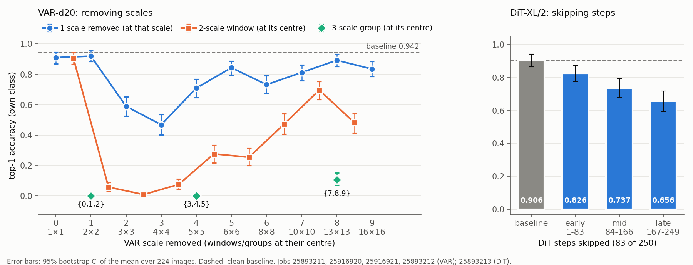
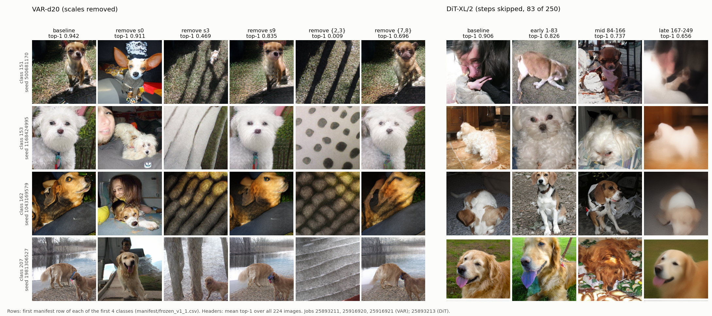

# P1: stage removal

Remove one group of generation stages and measure what the image loses, on VAR (scales) and DiT
(denoising steps). Every removal run is paired with a clean baseline from the same job and recorded with
P2's schema (`lanes/p2/schema.py`, `--lane p1`).

| File | What |
|---|---|
| `hooks.py` | `remove_scales`: VAR removal, variant (b), scales from `P1_VAR_SCALES` |
| `jobs/gateb.pbs` | Baseline + removal arms per model, scoring, tables, `summary.txt` |
| `jobs/gateb_var.env`, `jobs/gateb_dit.env` | Gate B settings: the mid arm only |
| `jobs/sweep_var.env`, `jobs/sweep_dit.env` | Necessity sweep: early, mid and late arms per model |
| `jobs/sanity_var.env` | Positive control for the VAR hook: scale 9 alone, scale 0 alone |
| `jobs/single_var.env` | Single-scale sweep: each of VAR scales 1-8 alone |
| `jobs/window2_var.env`, `jobs/window3_var.env` | Sliding windows of 2 and 3 neighbouring VAR scales |
| `summarize.py` | One row per arm: means, paired drops vs baseline with bootstrap CIs, KID; `--compare` for arm vs arm; `--ranking-out` for the ranking |
| `plot_fig1.py` | Figure 1: VAR top-1 by removed scale / window, DiT top-1 per arm, with CIs |
| `failure_grid.py` | Figure 1b: four fixed example images under each VAR and DiT arm |
| `results/` | `results_sweep.csv`, `ranking.csv`, `compare_dit.csv`, `fig1.png`, `fig1b_failures.png` (all quoted below) |

## What "removal" means

**VAR, variant (b)** (`hooks.py`, as `scripts/examples/skip_scale_2.py`): a `Modify(when="after")` hook
sets `f_hat = f_hat_before` at each removed scale. That scale's contribution is dropped from the
accumulator, so later scales (whose input is read from `f_hat`) and the decoder never see it. Its tokens
are still sampled, so every row draws the same random numbers as the baseline and the run stays paired.

**DiT, skip + burn** (`runner.generate --skip-timesteps`, `docs/hook_interface.md` §11b): the model is
not evaluated at the skipped timesteps; the step before the window maps its latent straight to the level
after it, and each skipped step's noise is still drawn ("burned"), so the run stays paired.

## Stage groups and the equal-cuts rule

Each arm removes the same number of stages: **3 VAR scales**, **83 DiT steps** (a third of 250).

| Group | VAR scales (tokens of 680) | DiT step indices (0 = first of 250) |
|---|---|---|
| early | {0, 1, 2} (14) | 1-83 |
| mid | {3, 4, 5} (77) | 84-166 |
| late | {7, 8, 9} (525) | 167-249, the last 83 steps |

- VAR scale 6 (64 tokens) is never cut, so that each group is exactly 3 scales.
- DiT step 0 is never cut (the runner cannot skip it: there is no earlier step to merge into),
  mirroring VAR scale 6.
- The cut is equal in stages, not in work: the VAR groups remove very different token budgets
  (14 / 77 / 525 of 680 tokens; scale 9 alone is 256), while every DiT arm removes 83 model calls.
  Compare the arms with this in mind.
- The late DiT arm skips the final step, so the last kept step (166) goes straight to x_0.

DiT step indices are converted to timesteps from this job's own DiT baseline `run.json` (`stages`
table, `step` -> `timestep_in`). The job stops that arm if an index or timestep is not in the table,
or if the range does not give exactly 83 timesteps. VAR arms must list exactly 3 scales (`VAR_CUT`;
`sanity_var.env` and `single_var.env` set it to 1, `window2_var.env` to 2).

## Controls

- **Clean baseline.** Each job's baselines must be byte-identical (`tensor_sha256`, every row) to job
  25665469; `summary.txt` reports the comparison and the job fails on a mismatch.
- **Matched groups.** The three equal-cut groups are matched to each other: same number of stages
  (3 scales, 83 steps), only their position differs.
- **No random-cut arm.** Scales and steps are not exchangeable (each has its own resolution or noise
  level), so a random set of stages is not a meaningful null.
- **Known confound.** The VAR groups remove 14 / 77 / 525 of 680 tokens: position and token budget move
  together, and VAR results cannot separate them.
- **Hook positive control** (`jobs/sanity_var.env`). Removing scale 9 alone should give a near-normal
  dog. If it does not, the hook is wrong and no VAR result is valid. Scale 0 alone is reported alongside
  it.
- **Gate B observation** (jobs 25891860 VAR / 25891861 DiT). VAR `remove_mid` gave fur texture with no
  dog shape; DiT `remove_mid` gave disfigured but recognisable dogs. Interpretation is pending the
  positive control.

## Sliding-window design (VAR)

VAR scales are removed in windows of 1, 2 and 3 neighbouring scales, sliding along the ladder:

| Cut size | Windows | Jobs |
|---|---|---|
| 1 | {0} ... {9}: 10 | `sanity_var.env` (0, 9; job 25893211), `single_var.env` (1-8) |
| 2 | {0,1} ... {8,9}: 9 | `window2_var.env` |
| 3 | {0,1,2} ... {7,8,9}: 8 | `sweep_var.env` (012, 345, 789; job 25893212), `window3_var.env` (123, 234, 456, 567, 678) |

- Only neighbouring scales, not every combination (45 pairs, 120 triples): a window asks what a
  contiguous stretch of the coarse-to-fine ladder contributes, and stays affordable.
- Within each job every arm removes the same number of scales (`VAR_CUT` is checked per arm), so arms
  in one job differ only in position. Across cut sizes the token budget still differs (see Controls).
- Arms are compared with each other, within one job and over the same images, by
  `summarize.py --compare JOB:ARM_A,ARM_B` (paired difference A - B, 95% paired-bootstrap CI).

Arm vs arm, DiT sweep (`results/compare_dit.csv`, from
`python -m lanes.p1.summarize --compare 25893213:remove_mid,remove_late --compare 25893213:remove_early,remove_mid --compare-out lanes/p1/results/compare_dit.csv`).
Positive = arm A scores higher:

| job | A | B | n | top-1 A | top-1 B | A - B top-1 [95% CI] | cls_prob A | cls_prob B | A - B cls_prob [95% CI] |
|---|---|---|---|---|---|---|---|---|---|
| 25893213 | remove_mid | remove_late | 224 | 0.737 | 0.656 | 0.080 [0.000, 0.165] | 0.572 | 0.493 | 0.079 [0.014, 0.144] |
| 25893213 | remove_early | remove_mid | 224 | 0.826 | 0.737 | 0.089 [0.013, 0.165] | 0.681 | 0.572 | 0.109 [0.048, 0.170] |

Observations (not conclusions): early is above mid on both metrics, with both CIs above 0. Mid is above
late on cls_prob (CI above 0), but on top-1 the CI's lower end is 0.000, so the top-1 difference
between mid and late is not clearly non-zero.

## Results so far

| Job | What | Arms |
|---|---|---|
| 25893211 | VAR sanity (`sanity_var.env`) | scale 0 alone, scale 9 alone |
| 25893212 | VAR sweep (`sweep_var.env`) | early {0,1,2}, mid {3,4,5}, late {7,8,9} |
| 25893213 | DiT sweep (`sweep_dit.env`) | early 1-83, mid 84-166, late 167-249 |
| 25916920 | VAR single scales (`single_var.env`) | each of scales 1-8 alone |
| 25916921 | VAR 2-scale windows (`window2_var.env`) | {0,1}, {1,2}, ... {8,9} |

`window3_var.env` (the five 3-scale windows not yet run) is held back: the three 3-scale groups already
run span top-1 0.000-0.107, so further 3-scale windows are unlikely to separate positions.



Figure 1 (`results/fig1.png`, from `python -m lanes.p1.plot_fig1`; needs matplotlib). Left: VAR top-1
vs the removed scale (single scales), with 2-scale windows and the three labelled 3-scale groups at the
mean of their removed scales; each scale index shows its token-grid size. Right: DiT top-1 per arm.
Error bars: 95% bootstrap CI of each arm's mean over its 224 images (not the paired CI of the drop in
the table). Dashed line: clean baseline.



Figure 1b (`results/fig1b_failures.png`, from `python -m lanes.p1.failure_grid`; needs matplotlib +
Pillow): the same four images (first manifest row of each of the first four classes) under each VAR
and DiT arm, headed by the arm's mean top-1 over all 224 images.

Table from `lanes/p1/results/results_sweep.csv`; `lanes/p1/results/ranking.csv` from the same command:
`python -m lanes.p1.summarize 25893211 25893212 25893213 25916920 25916921 --out lanes/p1/results/results_sweep.csv --ranking-out lanes/p1/results/ranking.csv`.

`results/ranking.csv`: every removal arm per model, ordered by top-1 drop (largest first), with what it
removed, how many scales or steps, the VAR tokens removed, and the drop CIs and KID from this table.
Ties are broken by cls_prob drop, then job and arm: VAR {0,1,2} and {3,4,5} tie on both (0.942 / 0.811).
Means are over the 224 images. Drops are baseline - arm (positive = worse), with 95% paired-bootstrap
CIs over images (10000 resamples, seed 0). `img_mad255` is the distance from the baseline image
(0..255). KID is paired, against the job's own baseline.

| job | model | arm | n | top-1 | top-5 | cls_prob | img_mad255 | drop top-1 [95% CI] | drop cls_prob [95% CI] | KID |
|---|---|---|---|---|---|---|---|---|---|---|
| 25893211 | var | baseline | 224 | 0.942 | 1.000 | 0.812 | | | | |
| 25893211 | var | remove_s0 | 224 | 0.911 | 0.978 | 0.789 | 66.19 | 0.031 [-0.013, 0.076] | 0.023 [-0.016, 0.064] | 0.00315 |
| 25893211 | var | remove_s9 | 224 | 0.835 | 0.969 | 0.663 | 13.33 | 0.107 [0.058, 0.156] | 0.149 [0.115, 0.184] | 0.01216 |
| 25893212 | var | baseline | 224 | 0.942 | 1.000 | 0.812 | | | | |
| 25893212 | var | remove_early | 224 | 0.000 | 0.004 | 0.001 | 69.64 | 0.942 [0.911, 0.969] | 0.811 [0.781, 0.839] | 0.12059 |
| 25893212 | var | remove_mid | 224 | 0.000 | 0.004 | 0.001 | 41.39 | 0.942 [0.911, 0.969] | 0.811 [0.781, 0.839] | 0.11306 |
| 25893212 | var | remove_late | 224 | 0.107 | 0.254 | 0.064 | 22.03 | 0.835 [0.786, 0.880] | 0.748 [0.714, 0.781] | 0.15318 |
| 25893213 | dit | baseline | 224 | 0.906 | 0.960 | 0.759 | | | | |
| 25893213 | dit | remove_early | 224 | 0.826 | 0.938 | 0.681 | 50.59 | 0.080 [0.027, 0.134] | 0.078 [0.027, 0.129] | 0.00029 |
| 25893213 | dit | remove_mid | 224 | 0.737 | 0.884 | 0.572 | 46.45 | 0.170 [0.107, 0.237] | 0.187 [0.134, 0.240] | 0.01775 |
| 25893213 | dit | remove_late | 224 | 0.656 | 0.808 | 0.493 | 20.85 | 0.250 [0.188, 0.317] | 0.266 [0.217, 0.315] | 0.03127 |
| 25916920 | var | baseline | 224 | 0.942 | 1.000 | 0.812 | | | | |
| 25916920 | var | remove_s1 | 224 | 0.920 | 0.982 | 0.786 | 60.52 | 0.022 [-0.022, 0.071] | 0.026 [-0.016, 0.070] | 0.00209 |
| 25916920 | var | remove_s2 | 224 | 0.589 | 0.754 | 0.467 | 51.72 | 0.353 [0.281, 0.424] | 0.346 [0.290, 0.402] | 0.02491 |
| 25916920 | var | remove_s3 | 224 | 0.469 | 0.603 | 0.346 | 42.77 | 0.473 [0.402, 0.545] | 0.466 [0.413, 0.520] | 0.02846 |
| 25916920 | var | remove_s4 | 224 | 0.710 | 0.897 | 0.566 | 32.99 | 0.232 [0.174, 0.295] | 0.246 [0.202, 0.293] | 0.00963 |
| 25916920 | var | remove_s5 | 224 | 0.844 | 0.951 | 0.694 | 27.38 | 0.098 [0.049, 0.147] | 0.118 [0.082, 0.155] | 0.00451 |
| 25916920 | var | remove_s6 | 224 | 0.732 | 0.902 | 0.583 | 24.61 | 0.210 [0.156, 0.268] | 0.230 [0.187, 0.273] | 0.01244 |
| 25916920 | var | remove_s7 | 224 | 0.812 | 0.964 | 0.673 | 19.60 | 0.130 [0.080, 0.183] | 0.139 [0.105, 0.175] | 0.00501 |
| 25916920 | var | remove_s8 | 224 | 0.893 | 0.969 | 0.756 | 15.90 | 0.049 [0.009, 0.094] | 0.056 [0.030, 0.083] | 0.00231 |
| 25916921 | var | baseline | 224 | 0.942 | 1.000 | 0.812 | | | | |
| 25916921 | var | remove_s01 | 224 | 0.906 | 0.996 | 0.761 | 70.57 | 0.036 [-0.013, 0.085] | 0.051 [0.009, 0.093] | 0.00414 |
| 25916921 | var | remove_s12 | 224 | 0.058 | 0.103 | 0.051 | 61.04 | 0.884 [0.835, 0.929] | 0.761 [0.722, 0.799] | 0.06539 |
| 25916921 | var | remove_s23 | 224 | 0.009 | 0.022 | 0.004 | 50.93 | 0.933 [0.897, 0.964] | 0.808 [0.778, 0.837] | 0.08372 |
| 25916921 | var | remove_s34 | 224 | 0.076 | 0.125 | 0.046 | 43.43 | 0.866 [0.821, 0.911] | 0.766 [0.731, 0.801] | 0.08095 |
| 25916921 | var | remove_s45 | 224 | 0.277 | 0.438 | 0.190 | 34.80 | 0.665 [0.603, 0.723] | 0.622 [0.577, 0.666] | 0.06008 |
| 25916921 | var | remove_s56 | 224 | 0.255 | 0.402 | 0.179 | 30.00 | 0.688 [0.625, 0.746] | 0.634 [0.589, 0.678] | 0.07265 |
| 25916921 | var | remove_s67 | 224 | 0.473 | 0.732 | 0.346 | 25.60 | 0.469 [0.402, 0.536] | 0.466 [0.420, 0.514] | 0.04702 |
| 25916921 | var | remove_s78 | 224 | 0.696 | 0.875 | 0.529 | 21.02 | 0.245 [0.188, 0.304] | 0.283 [0.241, 0.326] | 0.02102 |
| 25916921 | var | remove_s89 | 224 | 0.482 | 0.732 | 0.309 | 17.90 | 0.460 [0.393, 0.527] | 0.503 [0.461, 0.547] | 0.07275 |

Observations (not conclusions):
- The hook positive control passes: removing scale 9 alone keeps top-1 at 0.835, against 0.942 for the
  baseline.
- VAR collapses under any 3-scale removal: top-1 is 0.000 for early and mid, and 0.107 for late.
- Early removes 14 tokens yet collapses; late removes 525 and is the least harmful by the classifier
  (top-1 0.107, cls_prob 0.064, against 0.000 / 0.001 for early). Token count does not explain the VAR
  damage. By KID, though, late is the furthest from the baseline (0.153, against 0.121 early and
  0.113 mid), so "least harmful" holds for the classifier metrics only.
- DiT degrades but survives: top-1 is 0.826 (early), 0.737 (mid) and 0.656 (late), against 0.906 for the
  baseline.
- Single scales (s0-s9): the largest top-1 drops are at s3 (0.473, top-1 0.469) and s2 (0.353, top-1
  0.589). Only s0 and s1 have a top-1 drop whose CI includes 0. The drop is not monotone in scale: s6
  (0.732) is below both s5 (0.844) and s7 (0.812).
- 2-scale windows: {1,2}, {2,3} and {3,4} give top-1 0.058, 0.009 and 0.076. {0,1} keeps 0.906, its
  top-1 drop CI including 0. The highest of the other windows is {7,8} at 0.696, and {8,9} is lower at
  0.482.
- Every 2-scale window has a lower top-1 than either of its two single-scale arms (point estimates;
  for {0,1}, 0.906 against 0.911 and 0.920, within the CIs).

## How to run

On NSCC, from the repo root. Weights must already be on disk (the job sets `HF_HUB_OFFLINE=1` and never
downloads):

```bash
mkdir -p outputs/p1/pbs
python -m lanes.p2.quality --download          # once, on the login node: classifier weights for QUALITY=1
qsub -v SETTINGS=lanes/p1/jobs/gateb_var.env lanes/p1/jobs/gateb.pbs
qsub -v SETTINGS=lanes/p1/jobs/gateb_dit.env lanes/p1/jobs/gateb.pbs

qsub -v SETTINGS=lanes/p1/jobs/sanity_var.env lanes/p1/jobs/gateb.pbs   # hook positive control, ~4 min
qsub -v SETTINGS=lanes/p1/jobs/sweep_var.env lanes/p1/jobs/gateb.pbs    # VAR early/mid/late, ~5 min
qsub -v SETTINGS=lanes/p1/jobs/sweep_dit.env lanes/p1/jobs/gateb.pbs    # DiT early/mid/late, ~26 min
qsub -v SETTINGS=lanes/p1/jobs/single_var.env lanes/p1/jobs/gateb.pbs    # VAR scales 1-8 alone, ~10 min
qsub -v SETTINGS=lanes/p1/jobs/window2_var.env lanes/p1/jobs/gateb.pbs   # VAR windows of 2, ~11 min
qsub -v SETTINGS=lanes/p1/jobs/window3_var.env lanes/p1/jobs/gateb.pbs   # VAR windows of 3, ~7 min
tail -f outputs/p1/<JOBID>/job.log             # ends with "P1 DONE: all runs recorded and paired"
```

The project (`personal-gura0001`) is in the job header; override it with `qsub -P <id>`. Per model the
job runs the baseline, then each arm in `VAR_ARMS` / `DIT_ARMS`; after each run: `schema record`
(pairing check), `analyze images` (not for the baseline) and `quality`; at the end `schema collect`
into `outputs/p1/<JOBID>/tables/`. Each step's exit code and duration go to `steps.tsv`.

`summary.txt` lists every run with its step exit codes and pairing result, and compares each baseline
row by row (`tensor_sha256`) with the reference baseline `BASELINE_REF` (default
`outputs/baseline/25665469`): PASS, FAIL (the job exits 1), or SKIPPED if the reference is not there.
The per-row tables are at the end of the summary and in `outputs/p1/<JOBID>/<model>/hash_vs_ref.tsv`.

Options (environment, or in the `SETTINGS` file): `VAR_ARMS="NAME:S,S,S ..."`,
`DIT_ARMS="NAME:A-B ..."`, `VAR_CUT`, `DIT_CUT`, `RUN_VAR`, `RUN_DIT`, `QUALITY`, `MANIFEST`,
`BASELINE_REF`, `EXP_TAG`, `KEEP_RAW`.

**Raw tensors (`KEEP_RAW`).** Each run saves one raw output tensor per image (`*.pt`, about 170 MB per
224-image run). Nothing downstream reads them: scoring uses the PNGs, and each tensor's `tensor_sha256`
stays in `run.json` for the hash checks. `KEEP_RAW=1` (the default) keeps them, so the gateb, sweep and
sanity env files behave as before. With `KEEP_RAW=0` (`single_var.env`, `window2_var.env`,
`window3_var.env`):
- an arm's `*.pt` are deleted as a `drop_raw` step only after its record, image-distance and quality
  steps have all succeeded; a failed arm keeps them;
- the baseline's `*.pt` are deleted only after every arm of the job has finished, and only if no step
  of the job failed;
- only `*.pt` directly inside a run directory (one with a `run.json`) under this job's
  `outputs/p1/<JOBID>/` are deleted. PNGs, `run.json`, metrics and features are kept, and the reference
  baseline `outputs/baseline/25665469` (`BASELINE_REF`) is never touched.

**P3 ride-along.** `P3_RIDEALONG=1` adds P3's observe hook (`lanes/p3/p3_observe.py:var_stages`) to the
VAR baseline only, writing to `outputs/p1/<JOBID>/p3_var_stages`. It is an Observe hook, so the
baseline images must still match the reference; the hash comparison checks this. DiT has no ride-along.
